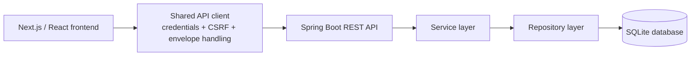

# Implementation Alignment Supplement

**Status:** implementation snapshot for the current `develop` branch. This document supplements, but does not replace, the approved SRS or the SDS PDF.

## 1. Current navigation and screen responsibilities

| Navigation item | Frontend component | Access | Current responsibility / integration |
| --- | --- | --- | --- |
| Dashboard | `DashboardOverview.tsx` | Admin, Staff | Reads live summary and recent sales from `GET /api/dashboard`; includes loading, unavailable, empty, and refresh states |
| Books Inventory | `BooksInventory.tsx` | Admin, Staff (Staff is read-only) | Lists/searches products, displays SKU and minimum stock, and provides Admin-only create/update/delete and low-stock filtering |
| Sales / POS | `SalesPOS.tsx` | Admin, Staff | Loads live products, submits a sale using product IDs and quantities, and retrieves the persisted receipt |
| Suppliers | `Suppliers.tsx` | Admin | Lists and creates persisted supplier records through the supplier API |
| Sales History | `SalesHistory.tsx` | Admin, Staff | Displays saved cash sales and multi-item receipt details from `GET /api/sales`; search/date filtering is currently client-side over the returned list |
| Purchase Orders | `PurchaseOrders.tsx` | Admin | Separate navigation view for purchasing: create/list purchase orders and receive eligible `ORDERED` orders |
| School Orders | `SchoolOrders.tsx` | Admin | Registers schools, creates/lists school orders, updates supported statuses, and retrieves saved quotations |
| Reports | `Reports.tsx` | Admin | Loads backend sales/inventory reports, validates date ranges, and supports report printing |
| Settings | `Settings.tsx` | Admin | Manages Staff accounts using documented user endpoints; unsupported store-profile settings are explicitly not presented as working controls |

The role policy is centralized in `frontend/src/lib/permissions.mjs`. Hiding a screen or button is only a usability measure: Spring Security backend authorization remains the security boundary.

## 2. Scope notes requiring project-owner confirmation

- **Sales History:** this is a distinct implemented screen, but it is not separately listed in the current SRS screen hierarchy. Treat it as an implementation extension pending formal approval/change-record traceability. Do not silently amend the SRS.
- **Purchase Orders:** this is a separate navigation view for the purchasing workflow. The SDS currently groups purchasing/goods-received responsibilities under Suppliers. The screen split is a presentation decision; confirm with the project owner whether the SDS should describe it as a separate screen or as a sub-screen of Suppliers.
- **Payment scope:** POS and Sales History remain cash-only. No Card or Online payment options are introduced.

## 3. Implemented architecture versus planned desktop shell

The backend follows the documented Controller → Service → Repository → Entity/Database separation. The frontend currently runs as a Next.js web application and talks to the local loopback Spring Boot API.

**Electron is planned, not implemented.** There is no checked-in Electron main process, preload bridge, managed backend child-process lifecycle, installer configuration, or reproducible Windows installer workflow in the current repository. The desktop runtime must not be represented as a delivered component until issue #279 is completed and verified.

## 4. Repository structure snapshot

- `frontend/`: Next.js App Router UI, shared API client, module components, Node-based unit/regression tests.
- `backend-bookstore-management-system/`: Spring Boot REST API, SQLite persistence, Maven wrapper, backend tests, API and operational documentation.
- `docs/requirements/`: approved SRS PDF.
- `docs/design/`: SDS PDF and this implementation-alignment supplement.
- `.github/workflows/`: CI workflows.
- `desktop/`: not present; planned work under issue #279.

## 5. Validation and release caveats

- Frontend automated tests run with `cd frontend; npm test`; they currently emphasize deterministic API/model/accessibility contracts. They are not yet comprehensive React component tests for every workflow.
- Frontend CI runs tests, ESLint, and a production build.
- Actual Windows 10/11 installer, offline-machine, printer, scaling, and second-contributor acceptance checks remain external/manual tasks.
- Reconcile the SDS PDF diagrams and screen list with this snapshot before treating the SDS as release-current. This supplement records implementation facts but does not claim formal approval of scope additions.
