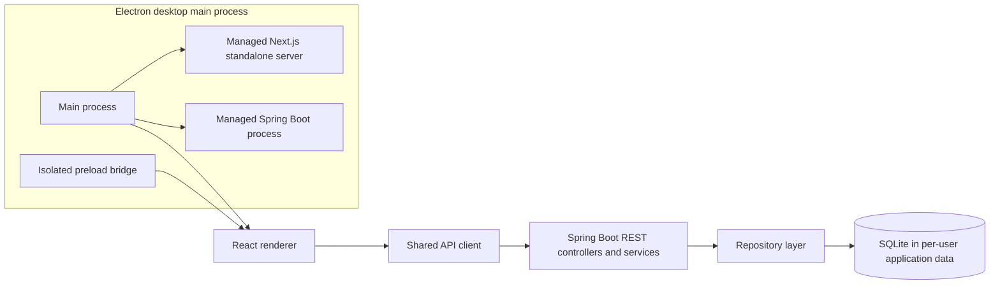

# Implementation Alignment Supplement

**Status:** implementation snapshot for the integration release represented by PR #369 and the current `develop` history. This document supplements, but does not replace, the approved SRS or SDS PDF.

## 1. Current navigation and screen responsibilities

| Navigation item | Frontend component | Access | Current responsibility / integration |
| --- | --- | --- | --- |
| Dashboard | `DashboardOverview.tsx` | Admin, Staff | Reads live summary and recent sales from `GET /api/dashboard`; includes loading, unavailable, empty, and refresh states |
| Books Inventory | `BooksInventory.tsx` | Admin, Staff (Staff read-only) | Lists/searches products, displays SKU and minimum stock, and provides Admin-only create/update/delete and low-stock filtering |
| Sales / POS | `SalesPOS.tsx` | Admin, Staff | Loads live products, submits sales using product IDs and quantities, then retrieves the persisted receipt |
| Suppliers | `Suppliers.tsx` | Admin | Lists and creates persisted supplier records through the supplier API |
| Sales History | `SalesHistory.tsx` | Admin, Staff | Displays saved cash sales and historical receipt details from `GET /api/sales`; receipt lookup uses `GET /api/sales/{saleId}/receipt` |
| Purchase Orders | `PurchaseOrders.tsx` | Admin | Separate purchasing view: create/list purchase orders and receive eligible `ORDERED` orders |
| School Orders | `SchoolOrders.tsx` | Admin | Registers schools, creates/lists school orders, updates supported statuses, and retrieves saved quotations |
| Reports | `Reports.tsx` | Admin | Loads backend sales/inventory reports, validates date ranges, filters results, and supports report printing |
| Settings | `Settings.tsx` | Admin | Manages Staff accounts; desktop builds also expose guarded database backup/restore file selection and confirmation |

The role policy is centralized in `frontend/src/lib/permissions.mjs`. Hiding a screen or button is only a usability measure: Spring Security backend authorization remains the security boundary.

## 2. Scope and traceability notes

- **Sales History:** a distinct implemented screen and API-backed capability. It is an implementation extension beyond the original SRS screen hierarchy; formal approval/change-record traceability is still required. Do not silently amend the SRS.
- **Purchase Orders:** a separate navigation view for purchasing and goods receipt. The original SDS groups purchasing under Suppliers. This supplement records the delivered separation; the SDS must explicitly document it as a screen or sub-screen after project-owner scope confirmation.
- **Payment scope:** POS and Sales History remain cash-only. No card or online payment flow is introduced.
- **External actors:** School, Supplier, and Walk-in Customer remain outside the BMS authentication boundary; they do not receive application accounts.

## 3. Delivered application architecture

The Electron main process starts the Spring Boot backend first and waits for `/api/health` to report both backend and database readiness. It then starts the Next.js standalone server and waits for local HTTP readiness before creating the BrowserWindow.

The renderer uses context isolation, sandboxing, disabled Node integration, restricted navigation, and a minimal preload bridge. Backend and frontend services bind to loopback. SQLite is stored in the per-user application-data directory, outside the installer directory, so upgrades do not replace the database. The main process owns child-process shutdown and escalates if a service does not exit normally.

The backend retains the Controller → Service → Repository → Entity/Database separation. The shared frontend API client handles credentials, CSRF, response envelopes, and structured HTTP/network errors.

## 4. Desktop operations

- **Backup/restore:** native save/open dialogs are registered in the Electron main process and accept requests only from the trusted local renderer. Restore requires destructive-operation confirmation and returns the UI to sign-in.
- **Receipt printing:** saved receipts support the system print dialog and 58 mm, 80 mm, and A4/PDF layouts. Physical printer selection, paper calibration, and output quality still require target-printer acceptance.
- **Shutdown:** both managed child processes are stopped during application exit; unexpected child termination is surfaced to the user.
- **Offline runtime:** the packaged application uses local services and a local SQLite database. A clean Windows machine must still complete the offline acceptance checklist with external connectivity disabled.

## 5. Repository structure snapshot

- `frontend/`: Next.js App Router UI, shared API client, module components, Node contract tests, and Vitest/React Testing Library component/session tests.
- `backend-bookstore-management-system/`: Spring Boot REST API, SQLite persistence, Maven wrapper, backend tests, and API/operational documentation.
- `desktop/`: Electron main process, preload bridge, runtime helpers/tests, packaging configuration, and Windows acceptance checklist.
- `docs/requirements/`: approved SRS PDF.
- `docs/design/`: SDS PDF and this implementation-alignment supplement.
- `.github/workflows/`: frontend, backend, Windows desktop, and dependency-security workflows.

## 6. Automated validation and remaining acceptance

Automated CI now covers:
- Frontend Node contract/model/accessibility tests and React component/session tests, followed by ESLint and production build.
- Backend Maven test suite, including restore fidelity checks comparing saved row values across all eleven business tables.
- Windows standalone frontend build, backend package, bundled Java runtime, Electron runtime tests, and NSIS installer artifact.
- npm high/critical dependency audit; Maven dependency scanning is triggered by Maven dependency-manifest changes and on the weekly schedule.

The following are not claimed as complete by CI alone:
- Clean Windows 10/11 offline workflow acceptance.
- Target-window display scaling and low-spec performance measurements.
- Physical printer selection, paper sizing, and output quality.
- First-time-clerk usability session with a real clerk.
- Canonical SRS/SDS PDF diagram and screen-map updates. This supplement does not replace those approved documents or approve scope changes.
